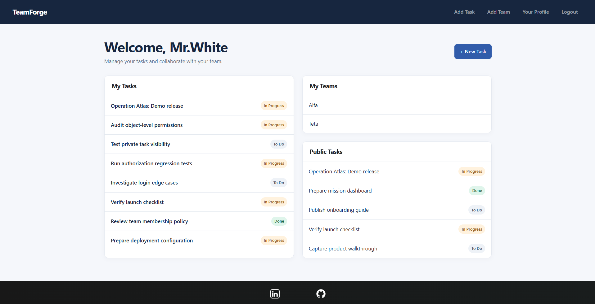
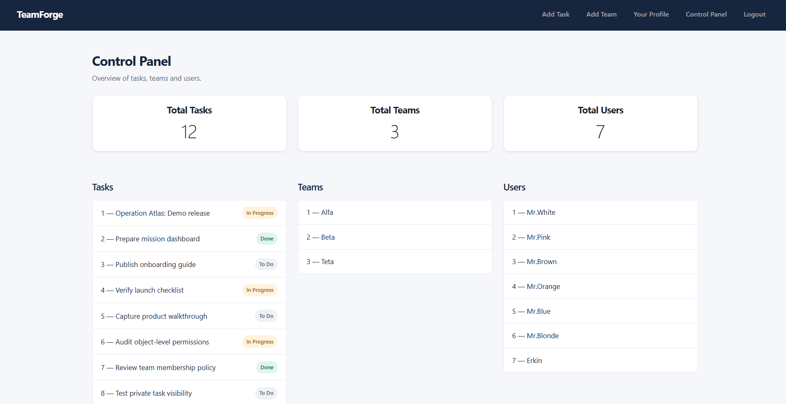

# TeamForge

**A collaborative task manager built with Django.**

Users can create tasks, assign them to people or teams, set deadlines, and track progress. Tasks can also be private, which makes permissions an important part of the project.

For example, someone assigned to a task can update it, but cannot delete it unless they created it. A private task assigned to a team must be visible to that team's members without becoming visible to everyone else. These checks happen in the Django backend, not just in the interface.

The repository includes **21 automated tests** focused on task and team permissions.

[Hosted app](https://teamforge.alwaysdata.net/) · [Permission rules](docs/PERMISSIONS.md) · [Running the tests](#tests)

## Screenshots

**Dashboard** — assigned tasks, teams, and public tasks in one place.



**Control Panel** — an overview of users, teams, and tasks for administrators.



<!--
## Workflow demo


-->

## What it does

- Create tasks with descriptions, deadlines, and three statuses: To Do, In Progress, and Done.
- Assign tasks to individual users or whole teams.
- Choose whether a task is public or private.
- Link subtasks to larger tasks.
- Create teams and manage their members.
- Register, sign in, and manage a profile.
- Use the admin-only Control Panel to browse users, teams, and tasks.

## Permissions

A public task is visible to any signed-in user. Private tasks are restricted to the people involved.

| Action | Allowed users |
| --- | --- |
| View a private task | Creator, assigned user, member of an assigned team, or superuser |
| Edit a task | Creator, assigned user, member of an assigned team, or superuser |
| Delete a task | Creator or superuser |
| Edit or delete a team | Member of that team or superuser |

One deliberate simplification is that **teams do not have separate owner and admin roles**. Any team member can manage membership or delete the team. That works for trusted groups, but it would need stricter roles in a larger application where team members should not have equal control.

The [permission document](docs/PERMISSIONS.md) describes the remaining rules, including team invitations and leaving a team.

## A few implementation choices

- **Django views enforce access rules.** `tasks/permissions.py` contains shared checks for task visibility and editing; deletion and team-management checks are enforced at their request handlers.
- **Relationships are modelled in the database.** Django's built-in `User` model connects to tasks and teams through foreign keys and many-to-many relationships.
- **Subtasks use a directed self-referencing relationship.** A task can link to other tasks without adding a separate subtask model.
- **The UI is server-rendered.** Django templates and Bootstrap were enough for this project; there is no REST API or frontend framework to maintain.

The details and trade-offs are in [Architecture](docs/ARCHITECTURE.md) and [Data Model](docs/DATA_MODEL.md).

## Tests

There are **21 Django `TestCase` tests** in `tasks/tests.py`. They check cases such as assigning a team you do not belong to, preventing collaborators from deleting tasks, stopping outsiders from changing team membership, and requiring POST for destructive actions.

```bash
python manage.py test tasks -v 2
```

These tests focus on authorization rather than covering every feature of the application. See [Testing](docs/TESTING.md) for the covered cases and remaining gaps.

## Tech stack

| | |
| --- | --- |
| Backend | Python, Django 6.1.3 |
| Database | SQLite |
| UI | Django templates, Bootstrap |
| Static files | WhiteNoise |
| Tests | Django `TestCase` |

## Run locally

**1. Clone the repository and install dependencies.**

```bash
git clone https://github.com/ErkinTunc/TeamForge
cd Collaborative-Task-Backend
python -m venv .venv
```

Activate the environment:

```powershell
# Windows PowerShell
.\.venv\Scripts\Activate.ps1
```

```bash
# macOS / Linux
source .venv/bin/activate
```

Then install the requirements:

```bash
pip install -r requirements.txt
```

**2. Set the environment variables for local development.**

PowerShell:

```powershell
$env:DJANGO_SECRET_KEY = python -c "from django.core.management.utils import get_random_secret_key; print(get_random_secret_key())"
$env:DJANGO_DEBUG = "1"
$env:DJANGO_LOCAL_HTTP = "1"
```

macOS / Linux:

```bash
export DJANGO_SECRET_KEY="$(python -c 'from django.core.management.utils import get_random_secret_key; print(get_random_secret_key())')"
export DJANGO_DEBUG=1
export DJANGO_LOCAL_HTTP=1
```

**3. Start the app.**

```bash
python manage.py migrate
python manage.py runserver
```

Open [http://127.0.0.1:8000/](http://127.0.0.1:8000/) and register an account.

The repository includes a SQLite database with sample tasks and teams. It is for local demonstration, not production data. Do not use `DJANGO_DEBUG=1` or `DJANGO_LOCAL_HTTP=1` in production.

## Documentation

- [Architecture](docs/ARCHITECTURE.md)
- [Data Model](docs/DATA_MODEL.md)
- [Permissions](docs/PERMISSIONS.md)
- [Security Review](docs/SECURITY.md)
- [Testing](docs/TESTING.md)
- [Course Context](docs/COURSE_CONTEXT.md)

## Contributors

- [Erkin Tunc BOYA](https://github.com/ErkinTunc)
- [Mohamed SAIDANE](https://github.com/Tounes-3220)
